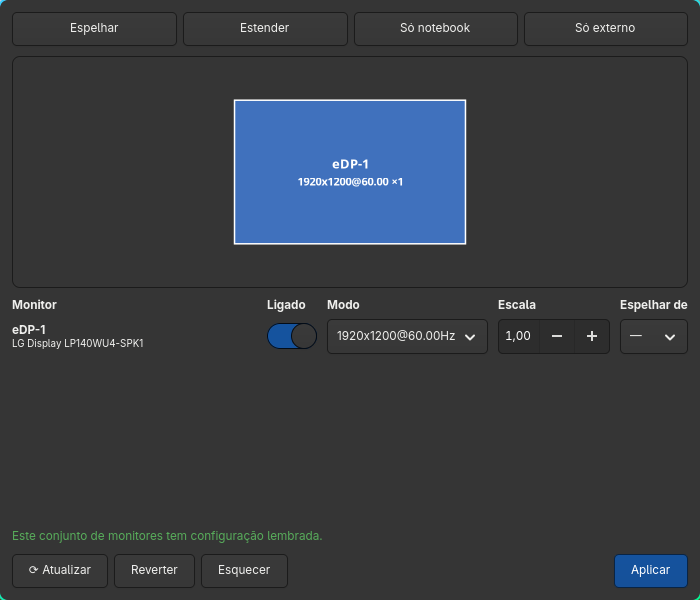

# SetTela

Janelinha GTK pra mexer nos monitores do Hyprland sem decorar `hyprctl keyword monitor`:
espelhar no projetor da facul, ligar/desligar telas e arrastar a disposição.
Puro Python + PyGObject (GTK4), zero deps além disso.



## Abrir

- `Super+P`
- `settela` sem argumento no terminal (os subcomandos `settela espelhar | so-externo | normal`
  do `.bashrc` continuam iguais)

## O que tem

- **Espelhar / Estender / Só notebook / Só externo** — aplicam na hora
- **Desenho** com os monitores ligados — arrasta e ele gruda na borda do vizinho
  (alinha topo/base/centro quando chega perto)
- **Por monitor**: ligado, modo (resolução@Hz), escala, espelhar de
- **Aplicar** manda tudo num `hyprctl --batch` só
- Depois de aplicar aparece *"Manter esta configuração?"* — se ninguém responder em 15 s,
  volta sozinho (salva a pele quando o projetor deixa a tela inutilizável)
- **Reverter** volta pra como estava quando a janela abriu; **⟳ Atualizar** relê depois de plugar cabo
- A janela (e o diálogo) se recentraliza sozinha quando a escala muda, e encolhe se não couber

## Lembra por conjunto de monitores

Clicou **Manter** → a configuração fica lembrada pro conjunto plugado agora, identificado pela
descrição de cada monitor (EDID), não pela porta. Ex.: *note + projetor da facul* lembra
"espelhar"; *note + LG* lembra "LG à direita". Fica em `pessoal/lembrados.json`.

O vigia (`settela.sh --vigiar`, sobe no `exec-once` do Hyprland) escuta o hotplug e:
- quando o conjunto muda (plugou/desplugou), reaplica o lembrado dele e avisa por notificação
- depois de `hyprctl reload`, reaplica o lembrado (o reload volta pra regra do `hyprland.conf`)
- se ficar sem nenhuma tela ligada (ex.: "Só externo" e tirou o cabo), religa o notebook

**Esquecer** apaga o lembrado do conjunto atual. Nada é escrito na config do Hyprland.

## Arquivos

- `settela.py` — tudo (lógica pura em cima, janela GTK embaixo)
- `settela.sh` — launcher (usado pelo bind)
- `settela_test.sh` — testa a lógica com JSON fixo, não chama o hyprctl
- `pessoal/lembrados.json` — config lembrada de cada conjunto (criado no primeiro Manter)
- `configs.json` — monitor principal (`eDP-1`) e escala padrão dele (`1.25`, que os atalhos restauram)

## Testar sem cabo

Monitor virtual não tem descrição, então a chave dele é o nome (muda a cada create).

```
hyprctl output create headless     # cria HEADLESS-N
~/deving/desktop/SetTela/settela.sh
hyprctl output remove HEADLESS-N
```
